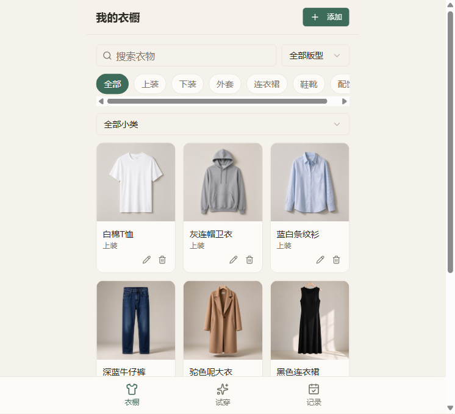
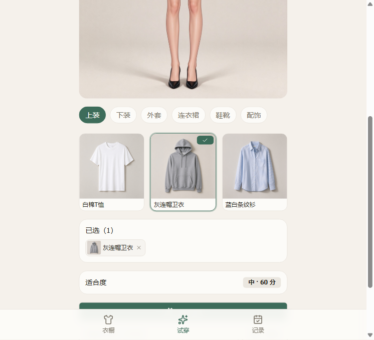
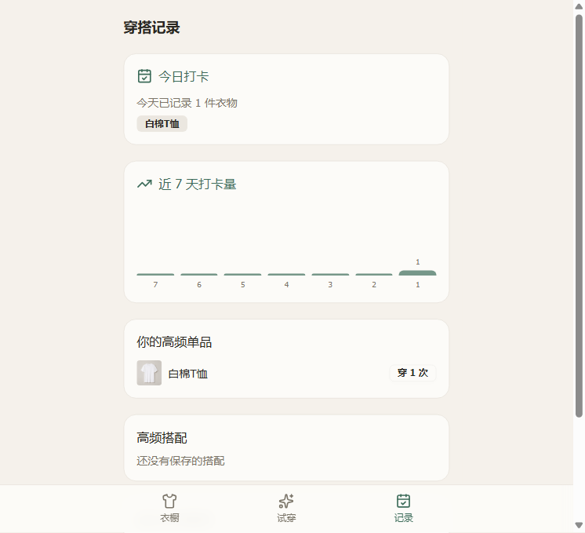

# 我的衣橱 · My Wardrobe

一个纯前端的穿搭训练小程序（H5）：把已有的衣服存入衣橱，在可选择性别与体型的虚拟人物形象上点选搭配，快速看这套组合适不适合自己，并记录实穿率与每日打卡。

> 本项目为线上版「我的衣橱」的本地可运行前端重建版本。线上版（基于豆包平台沙箱）源码无法导出，本工程按同一份设计文档在本地重建，功能保持一致。

## 功能特性

- **衣橱管理**：按「大类 → 小类 → 版型」专业分层归类衣物；上传图片、AI 抠图、编辑、删除、搜索与多维度筛选。
- **虚拟试穿**：在人物形象上按上装 / 下装 / 外套 / 连衣裙 / 鞋靴 / 配饰六大类点选搭配；配饰支持多选，其余大类单选。
- **人物形象**：可选择女性 / 男性与多档体型（标准、娇小、丰满、大码、高挑、纤瘦等），并设置身高体重；形象底图随档位切换。
- **适合度评分**：结合体型与衣物版型 / 长度 / 修身度的轻量规则引擎，给出评分、评价与搭配雷点提示。
- **AI 试穿（本地模拟）**：一键生成试穿效果说明。本地版用前端模拟实现，接入真实 AI 时替换 `src/lib/mock-ai.ts` 中的两个函数即可。
- **穿搭记录**：每日打卡、近 7 天打卡量、高频单品、高频搭配与结合体型的偏好推荐。
- **数据本地化**：所有数据保存在浏览器 localStorage（项目命名空间 `my-wardrobe`），无需登录、跨设备不共享。

## 界面预览

| 衣橱 | 试穿 | 记录 |
|---|---|---|
|  |  |  |

## 技术栈

| 类别 | 选型 |
|---|---|
| 框架 | React 19 + TypeScript |
| 构建 | Vite 8 |
| 样式 | Tailwind CSS 4 |
| UI | shadcn/ui 组件库 |
| 路由 | react-router v7 |
| 动效 | framer-motion |
| 表单校验 | react-hook-form + zod（预留） |
| 数据存储 | 带项目命名空间的 localStorage（`scopedStorage`） |
| 图标 | lucide-react |
| 轻提示 | sonner |

## 快速开始

```bash
# 1. 安装依赖
npm install

# 2. 启动开发服务器（端口以 spark.json 中 dev.port 为准，默认 28888）
npm run dev

# 3. 构建生产包
npm run build

# 4. 静态检查（typecheck + eslint，要求 0 errors）
npm run lint
```

打开 `http://localhost:28888` 即可使用。

## 目录结构

```
src/
├── app.tsx                     # 路由入口
├── components/                 # 通用组件（Layout、MobileTabBar、ClothingCard、BodyAvatar、PageHeader）
├── pages/
│   ├── WardrobePage/           # 衣橱：分类筛选、增删改查
│   ├── TryOnPage/              # 试穿：人物形象、六大类搭配、评分、打卡
│   ├── OutfitLogPage/          # 记录：打卡、实穿统计、推荐
│   ├── AddClothingPage/        # 添/编辑衣物（支持 ?edit=id）
│   └── BodySettingsPage/       # 体型设置：性别、档位、身高体重
├── hooks/                      # useClothes / useBodyParams / useOutfits / useDailyLogs
├── lib/
│   ├── store.ts                # 命名空间 localStorage
│   ├── fit-rules.ts            # 适合度评分规则引擎
│   └── mock-ai.ts              # AI 抠图 / 试穿的本地模拟实现（替换点）
├── data/
│   ├── types.ts                # 数据模型
│   ├── wardrobe.ts             # 分类字典 + 示例衣物
│   └── body.ts                 # 体型档位字典
public/images/
├── bodies/                     # 10 张人物底图（女 6 档 + 男 4 档）
└── clothes/                    # 8 张示例衣物图
```

> 注：`src/index.tsx`（Provider 层）与 `src/components/ui/*`（shadcn 内置组件）由模板管理，勿修改。

## 数据模型

核心实体（`src/data/types.ts`）：

- `IClothing`：衣物（id / 名称 / 图片 / 大类-小类-版型 / 参数）
- `IOutfit`：搭配（名称 / 包含的衣物 id 列表 / 穿着次数）
- `IDailyLog`：每日打卡记录
- `IBodyParams`：人物体型（性别 / 体型档位 / 身高 / 体重）

存储键（命名空间 `my-wardrobe`）：`clothes`、`deleted_mock_ids`、`outfits`、`daily_logs`、`body`。

## AI 能力说明

本地重建版没有平台 AI 运行时，以下两项为**前端模拟实现**（用户确认以此为代表，流程可完整走通、效果非真实）：

- **AI 抠图**：`mockCutout(file)` 返回一个 dataURL，延迟模拟抠图过程。
- **AI 试穿**：`mockTryOn(clothes)` 返回一段试穿效果提示文本，延迟模拟生成。

接入真实 AI 时，仅需替换 `src/lib/mock-ai.ts` 中对应函数的内部实现，页面层无需改动。

## 已知限制

- 数据仅存于当前浏览器本地，换设备 / 换浏览器不共享。
- 示例衣物为 8 件（线上版为 22 件），覆盖六大类，主要用于演示。
- AI 抠图 / 试穿为模拟效果，非真实 AI 合成。
- 「已保存搭配一键还原 / 载入」功能尚未在本版本补齐。
